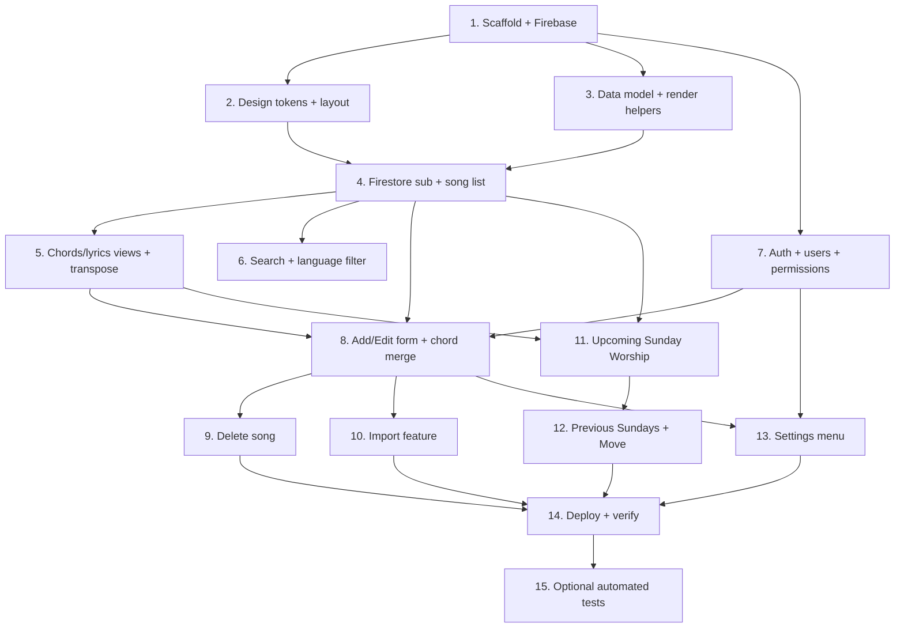

# Implementation Plan

## Overview

This plan reconstructs the Heart of Worship app from scratch. It is organised so a
developer (or Kiro) on any machine can build the whole thing in order. Tasks are
grouped by area; each references the requirements it fulfils. The live app has
already been built and deployed — this document captures the implementation order so
the project can be re-created or extended elsewhere.

## Tasks

- [ ] 1. Project scaffold and Firebase wiring
  - Create `index.html`, `styles.css`, `app.js` as plain static files (no build step).
  - Load Google Fonts (Fraunces, Inter), the Firebase compat SDK, and the import
    parsers (SheetJS, mammoth.js, pdf.js) from CDN in `index.html`.
  - Add `FIREBASE_CONFIG` to `app.js` and initialise `firestore()`, `auth()`, `storage()`.
  - Add cache-busting `?v=N` query params to the `styles.css` and `app.js` includes.
  - _Requirements: 12.1, 12.2, 12.6_

- [ ] 2. Design tokens and base layout
  - Define CSS variables (paper background, forest green, amber, Fraunces/Inter fonts).
  - Add the `[hidden] { display: none !important; }` rule so toggled controls hide.
  - Build the sticky header shell and the responsive action-button row.
  - _Requirements: 11.1, 11.2, 11.3, 11.6, 11.7_

- [ ] 3. Song data model and rendering helpers
  - [ ] 3.1 Implement `renderKeyBadge` (default green, female amber) and `renderTimeSig`
        (stacked fraction).
    - _Requirements: 1.1, 1.2, 1.3, 1.4, 2.7, 2.8, 11.3_
  - [ ] 3.2 Implement `isChordLine`, `renderChordChart`, and `renderLyricsOnly`.
    - _Requirements: 3.2, 3.3_
  - [ ] 3.3 Implement transpose helpers (`SHARP_SCALE`/`FLAT_SCALE`/`FLAT_KEYS`,
        `transposeChord`, `transposeChordLine`) preserving column alignment.
    - _Requirements: 3.5_

- [ ] 4. Firestore subscription and live song list
  - Subscribe to `songs` ordered by title; rebuild `allSongs` on each snapshot.
  - Implement the landing page where the list is hidden until "Show all songs".
  - Render song cards via `fullSongCardHtml` + `wireCardEvents` (expand/collapse).
  - Show empty-state message when there are no songs.
  - _Requirements: 2.1, 2.2, 2.3, 2.4, 2.5, 2.6, 2.9, 2.10, 2.11, 6.1, 6.2, 6.3_

- [ ] 5. Chords / lyrics views and transpose UI
  - Add the "With Chords" / "Lyrics only" view buttons and collapse-on-re-click.
  - Wire the transpose dropdown (chords view only); lyrics view has no transpose.
  - Make the chords view horizontally scrollable on mobile; keep lyrics readable.
  - _Requirements: 3.1, 3.4, 3.6, 3.7, 11.4, 11.5, 11.6_

- [ ] 6. Search and language filter
  - Implement live title/artist search and dynamic language chips (`deriveLanguages`).
  - Apply search + language filters together (intersection).
  - _Requirements: 5.1, 5.2, 5.3, 5.4, 5.5, 5.6_

- [ ] 7. Authentication, users, roles, permissions
  - [ ] 7.1 Implement login: match username/passcode against `config/users` (legacy
        `config/editor` fallback → admin), then `signInAnonymously()`.
    - _Requirements: 7.1, 7.2, 7.3_
  - [ ] 7.2 Store the resolved user in `sessionStorage`; restore on load.
    - _Requirements: 7.4_
  - [ ] 7.3 Implement permission helpers (`isAdmin`, `canAdd`, `canEdit`, `canDelete`,
        `canWriteAny`) and `applyPermissionUI` body classes to gate controls.
    - _Requirements: 7.4, 7.5, 7.6_
  - [ ] 7.4 Apply Firestore security rules (public read, auth-required write).
    - _Requirements: 7.7, 12.3, 12.4_

- [ ] 8. Add / Edit song form with chord-lyric merge
  - [ ] 8.1 Build the form with key/language dropdowns and two paste fields
        (`#f-chart` Chords & Lyrics, `#f-lyrics` Lyrics only).
    - _Requirements: 1.2, 1.5, 4.2_
  - [ ] 8.2 Implement `buildChart` dispatch: both fields → `mergeChordsOverMixedLyrics`
        (keep ALL chords, align over clean English, drop Malayalam from the chart);
        chords only → `normaliseChart`/`convertInlineChords`; lyrics only → store as-is.
        Store `lyrics` separately.
    - _Requirements: 4.3, 4.4, 4.5_
  - [ ] 8.3 Implement save (create/update by id), validation of required fields,
        cancel-discards-changes, and error-retains-data.
    - _Requirements: 1.9, 1.10, 4.8, 4.9, 4.10, 12.5_

- [ ] 9. Delete song
  - Add permission-gated delete with a confirmation prompt and live removal.
  - _Requirements: 7.6_

- [ ] 10. Import feature
  - Build the import dialog accepting CSV, XLSX, TXT, DOCX, PDF with a Malayalam/English
    selector and a preview before saving.
  - Implement extractors (`extractDocxText`, `extractPdfText`, SheetJS) and
    `buildFromPastedSong` to detect title/artist/key/time/language and chords/lyrics.
  - _Requirements: 4.1, 4.6, 4.7_

- [ ] 11. Upcoming Sunday Worship
  - [ ] 11.1 Build the Sunday dialog with the upcoming date (DD/MM/YYYY) and
        Malayalam/English groups of full cards.
    - _Requirements: 9.1, 9.2, 9.3, 9.5_
  - [ ] 11.2 Implement `toggleSunday` (★/✓) writing `config/sunday` and live sync.
    - _Requirements: 9.4, 9.7, 6.1, 6.2_
  - [ ] 11.3 Add admin-only "Clear all" with Yes/No confirmation.
    - _Requirements: 9.6_

- [ ] 12. Previous Sundays archive and Move-to-Previous
  - [ ] 12.1 Implement `renderPrevSundays` (newest-first, dated, grouped, read-only/locked)
        and the Previous Sundays dialog navigation.
    - _Requirements: 10.1, 10.2, 10.3_
  - [ ] 12.2 Implement `maybeArchivePastWeek` auto-archiving into `config/sundayHistory`
        when the week date passes.
    - _Requirements: 10.4_
  - [ ] 12.3 Implement the admin-only "Move to Previous Sunday" button: archive current
        songs under the worship date, empty `config/sunday`, roll week forward (which
        clears the ✓ On Sunday tags), then open Previous Sundays.
    - _Requirements: 10.5, 10.6, 10.7, 10.8_

- [ ] 13. Settings menu
  - [ ] 13.1 Settings gear → menu opening individual dialogs.
    - _Requirements: 8.1_
  - [ ] 13.2 Change background picture (admin): upload to Storage, apply, sync.
    - _Requirements: 8.2_
  - [ ] 13.3 Change theme colour (admin): palette overriding green CSS vars via
        `config/appearance.themeColor`.
    - _Requirements: 8.3_
  - [ ] 13.4 Manage users (admin): add/remove users with role + per-permission toggles.
    - _Requirements: 8.4_
  - [ ] 13.5 Reset password (any logged-in user).
    - _Requirements: 8.5_

- [ ] 14. Deploy and verify
  - Enable GitHub Pages (main / root). Apply Firestore + Storage security rules.
  - Verify real-time sync, mobile chord scrolling, modal corner close buttons, and the
    full Sunday → Move-to-Previous flow on desktop and mobile (private tab).
  - _Requirements: 12.1, 12.3, 12.4, 11.4, 11.5_

- [ ] 15. (Optional) Automated tests for pure logic
  - Add fast-check property tests (runner: Vitest) for the correctness properties in
    design.md: chord-merge preservation, lyrics-only has no chords, transpose
    correctness/alignment, filters, language derivation, Sunday snapshot reflection,
    move-to-previous, and upcoming-Sunday date computation.
  - _Requirements: 3.3, 3.5, 4.3, 5.1, 5.4, 9.7, 10.6_

## Task Dependency Graph



```json
{
  "waves": [
    { "wave": 1, "tasks": ["1"] },
    { "wave": 2, "tasks": ["2", "3", "7"] },
    { "wave": 3, "tasks": ["4"] },
    { "wave": 4, "tasks": ["5", "6"] },
    { "wave": 5, "tasks": ["8", "11"] },
    { "wave": 6, "tasks": ["9", "10", "12", "13"] },
    { "wave": 7, "tasks": ["14"] },
    { "wave": 8, "tasks": ["15"] }
  ]
}
```

## Notes

The live app has already been built and deployed; this plan documents the
implementation order so the project can be re-created or extended on another machine.
Checkboxes are intentionally left unchecked so the file can serve as a from-scratch
build guide. Tasks 1–14 cover the shipped functionality; task 15 is an optional
testing follow-up aligned to the correctness properties in `design.md`.
